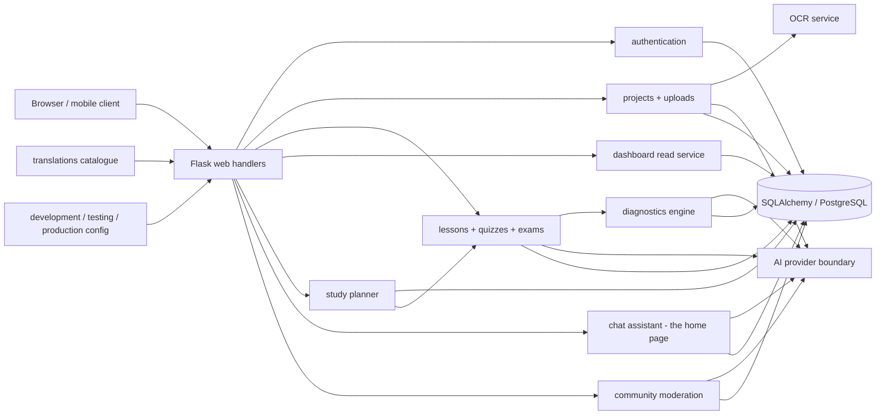

# Learnova architecture

## Design goals

Learnova uses a domain-oriented Flask architecture. HTTP handlers translate requests and responses; domain services perform validation and business work; SQLAlchemy owns persistence; AI transport is behind one provider boundary. Existing route endpoint names and the root `app.py` import surface remain stable for deployments and older tests.



## Folder structure

```text
learnova/
  ai_services/       provider boundary and shared tutor prompts
  authentication/    account normalization, validation and authentication
  dashboard/         optimized dashboard and daily-practice read models
  diagnostics/       evidence-based mistake diagnosis, knowledge model, adaptive policy
  assistant/         chat assistant (the home page): presets and tutoring layer, context window, titles, history groups and search snippets, reply formatting, Continue Learning rules
  moderation/        community content safety: preprocessing, classification contract, decision policy
  exams/             exam scoring and allocation rules
  lessons/           canonical subjects, subject teaching strategies, lesson plans and part guards
  ocr/               magic-byte validation, image processing and recognition helpers
  projects/          material report, topic map, Fachbegriff cards, coverage, scheduler
  quizzes/           deterministic mastery, scheduling and adaptive selection
  settings/          account preference domain namespace
  study_planner/     deterministic schedules, redistribution and readiness metrics
  translations/      single interface catalogue
  tutorial/          guided-tutorial registry (sections, steps, hooks), visibility/payload and progress rules
  uploads/           transactional upload/PDF ingestion
  utilities/         cross-cutting, domain-neutral helpers
  web/               response envelopes and browser security policy
  config.py          environment profiles
  extensions.py      unbound Flask extensions
templates/
  components/        navbar, footer, alerts, loading, modal mount and language selector
static/
  css/               tokens and shared components
  js/                core security/navigation, i18n, DOM and symbol modules
docs/                 architecture, diagnostics design, and extension guidance
app.py                compatible WSGI/CLI composition root and route orchestration
```

The top-level `adaptive_learning.py`, `document_processing.py`, `study_projects.py`, and `i18n.py` are compatibility shims. New code must import from `learnova.*`.

## Module responsibilities

| Module | Owns | Must not own |
| --- | --- | --- |
| `authentication` | credential validation, password-backed user creation, identity lookup | templates or redirects |
| `uploads` | one transaction for files/pages, de-duplication and page limits | request parsing |
| `ocr` | file signatures, conservative image work and recognition normalization; `ocr.local` is the on-server OCR engine seam (RapidOCR) with word boxes | account authorization |
| `vocabulary` | parsing, validation and practice rules; `language` (function-word detection), `layout` (blocks, columns, the sentence around a word), `translate` (DeepL / LibreTranslate / MyMemory behind one HTTP seam, cached) | Flask, the database, any language model |
| `ai_services` | cached/live gateway, the provider registry and sole provider client, per-provider request adapters (`adapters.py`), task routing and fallback (`routing.py`), token budgets (`budgets.py`), the usage-ledger interface, private cache keys, sanitized accounting, JSON parsing and shared prompts | database transactions or raw student-data logging |
| `assistant` | what the chat assistant is told to be (presets, the tutoring layer, the STUDENT CONTEXT block), what of a conversation the model sees (window with the pinned first turn), when a message may name a thread, date groups, search snippets and list cursors, reply post-processing (LaTeX backslash normaliser, hidden CHIPS/TOPIC/MEDIA lines, the media-offer veto and removal of model-written video links in `resources`), and the Continue Learning gate, transcript and lesson prompt (see `docs/ASSISTANT.md`) | persistence, authorization, the per-conversation send claim, quotas, or the provider call itself (all in `app.py`) |
| `media_enrichment`, `youtube_videos` | learning resources: Wikipedia/Wikimedia pictures with relevance and licence checks; YouTube Data API v3 search, availability check, ranking and cards behind one HTTP seam, the key only in a header (see `docs/LEARNING_RESOURCES.md`) | the database (the shared cache, the daily cap and the routes are in `app.py`), Flask, any language model |
| `moderation` | community safety vocabulary, text preprocessing and obfuscation signals, the classification contract, and the decision policy | provider access, database writes, or publishing anything itself |
| `projects` | page and document states, duplicate detection, topic-map extraction and reconciliation, Fachbegriff flashcards, learning coverage, the scheduler (see `docs/PROJECT_MODE.md`) | Flask globals, the database or AI calls |
| `lessons` | canonical subjects, the subject strategy registry, lesson step plans, part repair and guards that hold a lesson to the student's notes | Flask globals, the database or AI calls |
| `quizzes` | deterministic mastery, difficulty and spaced repetition | AI mastery decisions |
| `study_planner` | exam countdowns, task priority, schedule generation, incremental adaptation, redistribution, calendar/readiness metrics | Flask requests, ownership, AI decisions, or translated persistence text |

Browser-native speech recognition and speech synthesis are optional frontend accessibility adapters. Shared Jinja controls declare targets and accessible labels; `speech-to-text.js` and `text-to-speech.js` own capability detection, lifecycle cancellation, language selection, and single-active-session behavior. They do not send audio to Flask, persist raw audio, submit forms, or bypass normal answer review.
| `exams` | deterministic scoring and question allocation | answer visibility policy in templates |
| `dashboard` | user-filtered read queries and eager loading | mutations |
| `translations` | interface strings and frontend catalogue | learning records |
| `tutorial` | the guided tutorial's steps and what they light (`registry`), who sees which step and the translated JSON for `static/js/tour.js` (`visibility`), progress rules (`progress`) (see `docs/TUTORIAL.md`) | Flask, the database, the DOM |
| `contact` | contact-form validation, categories, the form timing token, the duplicate digest and the forward email (see `docs/CONTACT.md`) | Flask, the database or sending mail |
| `web` | JSON envelopes, headers and HTTP concerns | learning rules |

## Persistence and scaling

All ownership queries include the authenticated user. Composite indexes cover the high-volume user/review, lesson/attempt, project/page, section/order, exam/question, and study-plan/session paths. Migrations `009_add_query_path_indexes` and `011_add_intelligent_study_planner` upgrade existing SQLite and PostgreSQL databases additively. PostgreSQL is the production target; SQLite remains supported for local development and tests.

The in-memory `SESSIONS` dictionary is only a worker-local accelerator. `StudySession.state_json` is authoritative and restores progress after restarts. A future Redis adapter can replace the accelerator without changing stored lesson behavior.

`StudyPlan` owns exam goals and preferences. `StudyPlanSession` owns calendar tasks and completion; it is intentionally distinct from the legacy lesson-state `StudySession`. Routes parse and authorize, while `learnova.study_planner.service` receives plain data and performs deterministic scheduling. Completion hooks pass score/concept evidence back to the service and rewrite affected future sessions only. Tutor chat receives a sanitized summary of today's scheduled tasks, but AI cannot mutate dates, mastery, ownership, or completion.

### Deleting a project or a saved lesson (2026-11-13)

`POST /projects/<id>/delete` and `POST /lessons/<id>/delete` (`delete_project`, `delete_lesson` in
`app.py`) are plain forms on the dashboard (and, for a project, at the bottom of its workspace):
owner only (404 for anyone else), CSRF-protected, rate limited, one browser confirmation
(`static/js/confirm-delete.js`, `data-confirm-delete` on the form) and still a working POST without
JavaScript. `remove_project_records` / `remove_lesson_records` delete with bulk statements in
foreign-key order, children first, so PostgreSQL never sees a dangling id and no page image or
uploaded PDF (database columns) is loaded only to be deleted:

| Table | On project delete | On lesson delete |
| --- | --- | --- |
| `learning_project`, `project_file`, `project_page`, `document_block`, `learning_section`, `recall_card` | deleted | - |
| `competency` (Kompetenzraster rows), `exam_prep_state`, `study_plan`, `study_plan_session` | deleted | - |
| `final_exam`, `exam_question`, `exam_answer` | deleted | - |
| `lesson` with `section_id` in the project (project lessons) | deleted like a lesson | refused: part of its project |
| `lesson` with `project_id` = the project (made from its material outside a topic: mixed practice, targeted revision, exam-gap practice, each practice exam's "Exam review" lesson) | deleted like a lesson, so the exam's mistakes leave the Mistake Notebook and no copy of the notes stays in a saved state | allowed: a lesson of its own |
| `attempt`, `chat_message`, `study_session` | of the project lessons: deleted | deleted |
| `chat_attachment` (photos sent inside a lesson, `lesson_session_id`) | of the project lessons: deleted | deleted |
| `mastery_history` | kept, `attempt_id` set to NULL | kept, `attempt_id` set to NULL |
| `conversation_lesson` (chat links, no FK) | the `project` row deleted: the chat card offers the project again | the `lesson` rows deleted: the card offers the lesson again |
| `flashcard_set` / `flashcard` of the project | **detached**: `project_id`, `source_reference` and the cards' page ids cleared; a normal own set | - |
| `concept_mastery`, `xp_transaction`, `user_gamification_profile`, `league_entry`, `learning_event`, `usage_quota_event` | kept (XP is never revoked; no allowance refund - every project and lesson counts) | kept |

After the commit the deleted lessons leave the worker's `SESSIONS` and their cached AI results
(`ai_service.purge_cached`), and the remaining projects are planned again over the shared study time.
A new foreign key to one of these tables must be handled in those two functions.

`Lesson.project_id` (migration 047) is written with the lesson (`persist_lesson(..., project_id=)`
through `start_saved_practice`, and by `submit_final_exam` for the review lesson); the migration
linked the existing review lessons (by the exam id in their content) and mixed-practice / revision
lessons (by `session_kind: project_practice` and `project_id` in their saved state). An exam-gap
practice lesson from before 047 names no project and stays a Short Lesson.

Kept rows name deleted ones by id: the usage ledger's `project:<id>` reference and the learning
events' (and XP's) keys `attempt:<id>`, `recall:<id>:…`, `final-exam:<id>`, `study-plan-session:<id>`.
SQLite without `AUTOINCREMENT` hands the id of the deleted newest row to the next one, which counted a
new project as already counted (a free weekly project) and paid no XP for new answers. Those five
tables (`SQLITE_AUTOINCREMENT_TABLES`) declare `sqlite_autoincrement`, and migration 048
(`rebuild_sqlite_autoincrement`, SQLite only, checked on every start) rebuilds an existing table
that lacks it, keeping every id. PostgreSQL never reuses ids.

### Long lists: "Show more" (2026-11-13)

A list container with `data-show-more="N"` (and optionally `data-show-more-step="M"`) is folded
by `static/js/show-more.js` (rules in `show-more-rules.js`, tested by
`tests/js/show-more-rules.test.mjs`): the first N items, then one 44 px "Show more (rest)" button that
reveals M more, moves the focus to the first one and finally reads "Show less"
(`aria-expanded`, `aria-controls`). A list that would hide fewer than two items stays open. Nothing is
hidden before the script runs, so without JavaScript every item is shown. Used on the dashboard
(projects, Continue learning, Mistake Notebook, subjects, weakest and due concepts, improvements,
exams, flashcard and vocabulary sets) and in Settings (the code history). The plan comparison in
Settings stays open: it is a fixed description, not a growing list, and its "Shows ads" / "No ads"
lines must always be visible. "Weakest concepts" lists only concepts that are not yet strong
(`weak` or `learning`), so "Show more" never reveals mastered ones under that heading. Revealed
items and the button carry `scroll-margin-top` (the sticky navigation's height + 12 px), so the
focused button after "Show less" is never scrolled under the navigation.
`learnova.dashboard.LIST_CAPS` bounds how many rows each dashboard list loads (50 lessons and
projects, 30 concepts, improvements and exams); lesson answer/message counts and project page
counts are grouped queries, so the page costs the same number of queries for 5 or 40 lessons.

## Security boundaries

- secrets and provider credentials come from environment variables; production refuses to start without `SECRET_KEY`;
- CSRF protects unsafe form and JSON requests; tests are explicitly isolated;
- sensitive and AI-heavy endpoints are rate limited;
- uploads are checked by content signature and processed in memory;
- ORM expressions are used instead of interpolated SQL for user input;
- Jinja autoescaping remains enabled and JSON is emitted through `jsonify`/`tojson`;
- CSP, frame denial, MIME sniffing prevention, referrer, permissions and HTTPS HSTS headers are centralized.
